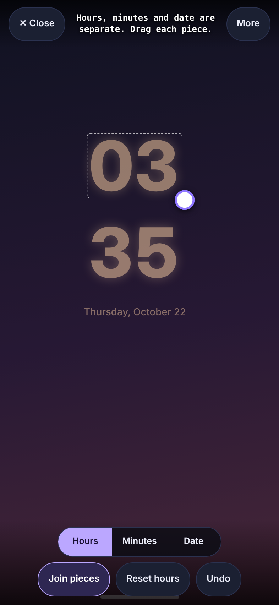
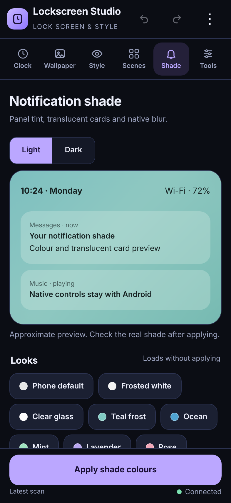
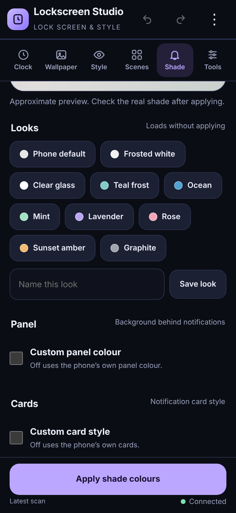
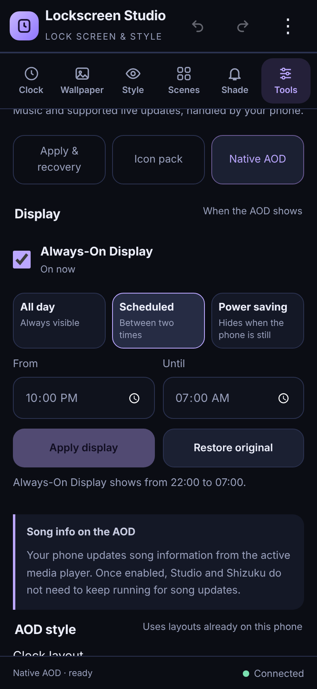

# Lockscreen Studio

[](https://github.com/EvanSunde/Realme-UI-customization/actions/workflows/ci.yml)
[](https://github.com/EvanSunde/Realme-UI-customization/releases/latest)
[](LICENSE)

Customise the **lock screen clock**, **notification shade** and **Always-On Display**
on realme UI 5 (ColorOS 14 / Android 14) **without root**. The app talks to the phone's
own Theme Store, SystemUI and AOD settings through [Shizuku](https://shizuku.rikka.app/),
backs up everything before it changes it, and can put it all back with one tap.

<p>
  
  
  
  
</p>

## Features

**Lock screen**
- Clock designer with 17 layouts (including Analog with live hands, Rings, Big minutes,
  Diagonal, Wave, Offset and Wide), 30 bundled fonts, and 18 finishes (including Photo fill) (glow, neon, chrome,
  holo, retro 3D, glitch, stencil and more). Also date styles, motion, and
  day/evening/night schedules.
- Full-screen preview: drag the clock (it moves with your finger instead of jumping),
  pinch to resize up to 600, and twist or use the corner handle to rotate.
- Separate hours, minutes and date: split the clock into three pieces and move, size
  and rotate each one on its own.
- Colour suggestions from your photo and from your current wallpaper (including live
  wallpapers that report their colours), for both the hours and two-tone minutes.
- Depth effect: put the subject of your photo in front of the clock (ML Kit separation
  or your own PNG). Works with Atmos live wallpapers.
- Stretch the clock wider or taller with the side and bottom handles.
- Give the hours, minutes and date their own colour, font, weight and finish, whether or
  not the clock is split. The date can be moved on its own in every layout.
- Up to three day counters (a number in a circle with an optional label, optionally
  yearly) and a daily quote from your own list. Both can be moved like the clock.
- Charging styles: glow pulse, colour shift, battery fill, charge ring or energy bar.
- Rings layout, and an optional seconds hand for Analog.
- Depth extras: choose which digits sit in front of the subject. Also: the subject's shadow
  on the clock, rim light from the clock, digits filled with your photo, a weight that
  changes through the hour, and parallax between the clock and the photo.
- Applies as a native Theme Store theme, with a confirm-or-revert timer in case
  something looks wrong.

**Notification shade**
- Panel colour, card colour, opacity and colour strength, with a light/dark preview.
- 10 built-in looks (Frosted white, Clear glass, Ocean, Mint, Lavender, Rose, Sunset
  amber, Graphite…) and your own saved looks.
- **Instant blur**: change only the shade blur in about a second, without a theme
  import. It also works in dark mode.

**Always-On Display**
- Turn AOD on or off and choose **All day**, **Scheduled** (from/until) or **Power saving**.
- Song title and artist on the native AOD, built-in clock styles, and Realme's smart
  updates.

**Also**
- Icon packs applied as a launcher theme module.
- Lock screen, shade colours, blur and AOD each change on their own.
- Shizuku access is granted once. The app reconnects by itself whenever Shizuku is
  running.

## Compatibility

| Tested on | Version |
| --- | --- |
| Phone | realme 9 (RMX3521) |
| OS | realme UI 5.0, Android 14 |
| Theme Store | 10.3.5 (`com.oplus.themestore`; `com.heytap.themestore` is also supported) |
| System UI / Always-On Display | 14.00.16 / 14.20.43 |

Other realme, OPPO and OnePlus phones on ColorOS 14 may work, but haven't been tested.
Please [open an issue](https://github.com/EvanSunde/Realme-UI-customization/issues/new/choose)
with your model and what worked.

## Install

1. Install and start [Shizuku](https://shizuku.rikka.app/guide/setup/). Wireless
   debugging works; root isn't needed.
2. Download the latest `Lockscreen-Studio-*.apk` from
   [Releases](https://github.com/EvanSunde/Realme-UI-customization/releases/latest) and
   install it.
3. Open the studio and grant Shizuku access once.

After a phone restart, start Shizuku again; Shizuku can't start itself without root.

> **Upgrading from 0.7.0 or earlier:** those builds were signed with a public
> development key. Later releases use a private key, so Android won't install them
> over an old build. Uninstall the old app once, then install the new one. Designs
> saved inside the app are lost when it is uninstalled; use **Scenes → Backup → Export all** first
> (photos must be re-selected after importing).

## Known limitations

- **Shade colours only show in light mode.** Realme's theme engine ignores
  SystemUI theme colours while dark mode is on, and this can't be changed without root.
  Blur still works in dark mode. See [docs/Shade-dark-mode.md](docs/Shade-dark-mode.md).
- The blur setting resets after a reboot; tap **Apply blur** again.
- AOD album artwork and playback buttons aren't available. See
  [docs/AOD-research.md](docs/AOD-research.md).
- Applying shade colours or a lock screen restarts SystemUI, so the screen flickers
  briefly.
- The new layouts, finishes, pieces and depth extras are drawn into the theme on the
  phone. The editor preview is a close approximation. Analog hands, rotation, charging
  styles, motion, digit depth and photo fill are still to be confirmed on a real lock screen.

## How it works

The app runs a small helper inside Shizuku's shell process (`ShellService`). That helper:

- **Lock screen and shade colours:** builds a native `.theme` package and hands it to
  Theme Store's own apply service. It keeps your other theme parts, checks that the
  files arrived, and restores the clock engine selection.
- **Blur:** sets SystemUI's blur property.
- **AOD:** writes the same secure settings Realme's AOD app writes.

Every change is backed up first under `/data/local/tmp/evan-lockscreen-*`, read back
afterwards, and can be restored from the app. Nothing is patched, re-signed or
installed into the system. Details are in [docs/technical-notes.md](docs/technical-notes.md).

## Build from source

Requirements: Linux, Python 3, Java 17+ (with `keytool`), and Node 18+ for the UI
checks.

```sh
python3 build.py          # downloads build tools, runs all Java checks, writes dist/*.apk
npm ci && npx playwright install chromium
npm run test:ui           # editor checks in a headless browser
```

Local builds are signed with a development key generated in `.signing/`. See
[CONTRIBUTING.md](CONTRIBUTING.md) for the project layout, conventions and how
releases are made.

## Contributing and security

Bug reports, device reports and pull requests are welcome; see
[CONTRIBUTING.md](CONTRIBUTING.md). The helper runs with shell (adb) privileges, so
please report security problems privately as described in [SECURITY.md](SECURITY.md).

## License

Copyright (C) 2026 EvanSunde and contributors.

Lockscreen Studio is free software: you can redistribute it and/or modify it under
the terms of the [GNU General Public License v3.0](LICENSE). It also grants an additional
permission under section 7 to combine the app with Google ML Kit and Google Play services
libraries. Bundled fonts (SIL OFL 1.1 / Apache 2.0) and Shizuku (MIT) keep their own
licenses. See [NOTICE.md](NOTICE.md).

This project isn't affiliated with or endorsed by realme, OPPO, OnePlus or Google. Their
names and trademarks belong to their owners. Use at your own risk: the app changes
system settings on your phone, although every change can be restored.
